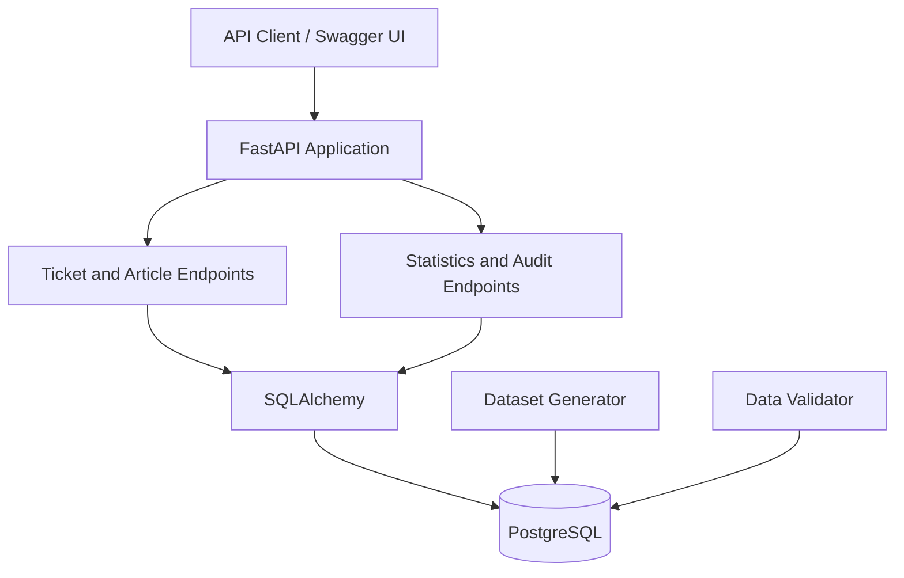

# Campus Support AI
### Policy-Grounded Campus Support, Ticket Tracking & Operational Auditing

Campus Support AI is a backend application designed to support student and faculty service requests through policy-grounded information retrieval, ticket tracking, operational metrics, and diagnostic auditing.

Built with **FastAPI, PostgreSQL, and SQLAlchemy**, the project demonstrates how campus support workflows can be organized, monitored, and evaluated for routing, policy-source, and service-level issues.

## Key Features

- **REST API:** FastAPI endpoints for ticket management, knowledge articles, statistics, and auditing.
- **Ticket Management:** Retrieve, list, and filter campus support tickets.
- **Policy & Knowledge Retrieval:** Search knowledge articles and inspect associated policy-source information.
- **Operational Analytics:** Access ticket statistics and service metrics.
- **Audit & Traceability:** Identify potential citation, routing, response-support, SLA, and escalation issues.
- **Data Integrity Validation:** Validate the seeded demonstration dataset and check structural consistency.
- **Automated Testing:** API tests using pytest and FastAPI's TestClient.

## Technology Stack

| Technology | Purpose |
|---|---|
| Python | Backend implementation |
| FastAPI | REST API framework |
| PostgreSQL | Relational database |
| SQLAlchemy | Database interaction and ORM |
| pytest | Automated testing |
| HTTPX / TestClient | API testing |

## Architecture

The application follows a straightforward backend architecture:



The API exposes operational data and diagnostic findings, while the database stores the entities used by the workflow. Dataset generation and validation scripts support reproducible demonstrations and integrity checks.

## Project Structure

```text
campus-support-ai/
├── backend/
│   ├── app/
│   │   ├── main.py
│   │   ├── db.py
│   │   └── models.py
│   ├── tests/
│   │   └── test_api.py
│   ├── create_tables.py
│   ├── generate_data.py
│   ├── validate_data.py
│   ├── requirements.txt
│   └── .gitignore
└── README.md
```

## Getting Started

### Prerequisites

- Python
- PostgreSQL
- Git (optional, for cloning the repository)

### 1. Clone the repository

```bash
git clone https://github.com/Aamer10121425/campus-support-ai.git
cd campus-support-ai
```

### 2. Create and activate a virtual environment

From the project root:

**Windows — Command Prompt**

```cmd
cd backend
python -m venv venv
venv\Scripts\activate.bat
```

**Windows — PowerShell**

```powershell
cd backend
python -m venv venv
.\venv\Scripts\python.exe -m pip install -r requirements.txt
```

If using PowerShell, the commands below can also use `.\venv\Scripts\python.exe` instead of `python`.

### 3. Install dependencies

If your virtual environment is activated:

```bash
python -m pip install -r requirements.txt
```

### 4. Configure PostgreSQL

Create a PostgreSQL database named `campus_support_ai`.

Configure the database connection using the environment variables expected by `app/db.py`. Store credentials in `backend/.env` if that is how your application is configured. Do not commit real credentials.

### 5. Create the tables

Run from the `backend` directory:

```bash
python create_tables.py
```

### 6. Generate demonstration data

```bash
python generate_data.py
```

Run this only against a fresh or intentionally reset demonstration database, according to the script's behavior.

### 7. Validate the dataset

```bash
python validate_data.py
```

Review the output for structural errors and diagnostic warnings.

### 8. Start the API

```bash
python -m uvicorn app.main:app --reload
```

### 9. Explore the API

Once the server is running, open:

- **Swagger UI:** http://127.0.0.1:8000/docs
- **ReDoc:** http://127.0.0.1:8000/redoc

These interfaces allow you to inspect and exercise the endpoints exposed by the application.

## API Reference

| Method | Endpoint | Purpose |
|---|---|---|
| GET | `/` | API information |
| GET | `/health` | Health check |
| GET | `/db-test` | Database connectivity check |
| GET | `/tickets` | List and filter tickets |
| GET | `/tickets/{ticket_id}` | Retrieve ticket details |
| GET | `/articles` | Search knowledge articles |
| GET | `/articles/{article_id}` | Retrieve article and policy-source information |
| GET | `/stats` | Ticket and operational statistics |
| GET | `/audit` | Run diagnostic audit checks |

For available query parameters, request schemas, and response formats, refer to the interactive Swagger documentation at `/docs`.

## Audit & Data Validation

The `/audit` endpoint evaluates several classes of potential workflow issues:

- Expired or unpublished article citations
- Unauthorized ticket routing
- Responses lacking policy-source support
- Overdue active tickets
- Business-hours SLA deadline mismatches
- Potentially missed escalations

### Audit assumptions and interpretation

- The configured business-hours assumption is Monday through Friday, 09:00–17:00 UTC.
- The demonstration dataset deliberately contains five planted anomalies.
- Additional findings, especially broad overdue-ticket and missed-escalation flags, may require investigation before being classified as confirmed violations.
- Detailed findings are capped at 500 per rule. A `truncated: true` indicator means the response contains only a subset of the detailed findings.

**Important:** Audit results are diagnostic signals, not automatic proof of policy violations. Business hours, routing permissions, escalation thresholds, and policy rules should be verified against the institution's actual requirements before operational use.

## Testing

Run the automated API test suite from the `backend` directory:

```bash
python -m pytest -v
```

**Recorded baseline:** 8 tests passed in the initial test run.

This is the baseline result, not a guarantee that every future version passes. Run the suite again after making changes.

## Security & Reliability

- Keep `.env` files and database credentials private.
- Exclude virtual environments, cache files, and other local-only artifacts from version control.
- Use environment variables for sensitive configuration.
- Run data validation after generating the demonstration dataset.
- Review audit findings before taking operational action.
- Use a properly configured production server and appropriate security controls before any real-world deployment.

## Current Scope & Limitations

The current implementation provides a working backend API, PostgreSQL persistence, a seeded demonstration dataset, data-validation checks, operational statistics, diagnostic auditing, and automated API tests.

The project is intended as a demonstration of campus support workflow management and policy-source auditing. The presence of policy-grounded retrieval endpoints does not, by itself, establish that a live large language model is integrated.

A production deployment would require institution-specific policy configuration, verified authorization rules, tested escalation thresholds, production-grade security, and operational monitoring.

## Future Improvements

Potential next steps include:

- A web dashboard for tickets, service metrics, and audit findings
- More granular role-based access control and routing validation
- Improved SLA calculations and escalation rules
- Additional edge-case and integration tests
- Clearer audit severity levels and remediation guidance
- Optional LLM integration with source-grounded answers and citation verification

## Project

**Repository:** [Aamer10121425/campus-support-ai](https://github.com/Aamer10121425/campus-support-ai)

**Status:** Backend implementation with database, API tests, demonstration data, and diagnostic auditing.
